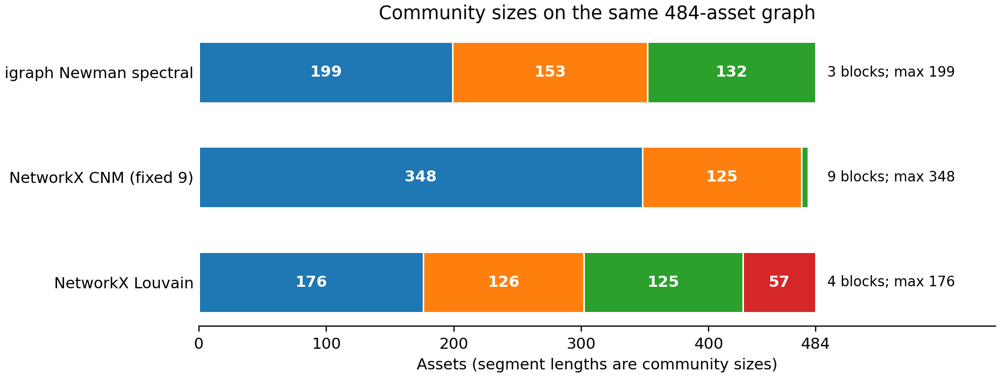

# Public community-library comparison

This optional experiment compares python-igraph 0.11.9 (C igraph 0.10.16)
Newman leading-eigenvector splitting, NetworkX 3.6.1 Clauset-Newman-Moore (CNM)
greedy modularity with exactly nine communities, and NetworkX Louvain at
resolution=1. The igraph method was subsequently adopted as the revision default;
these results retain their original experiment-source fingerprints.

All methods receive the absolute RMT-filtered correlation graph of the same
2016 N=484 data. A diagonal weight A_ii is represented as a graph loop of
A_ii/2: graph weighted degrees equal matrix row sums, and graph modularity
matches the original matrix formula. Both NetworkX and igraph modularity
outputs were checked against that formula. Removing diagonal terms instead
would define a different experiment.

The partition seed is fixed at 42 for each method. CNM uses cutoff=best_n=9;
igraph and Louvain use natural counts, without a count or size constraint.
The igraph ARPACK tolerance is explicitly 1e-10 with maxiter=10000. The exact
symmetric small-graph regression encountered nonconvergence under default
ARPACK settings; the explicit settings pass. Initial default-setting jobs
were stopped and their checkpoints retained separately; the results below
come from the final recorded configuration.

For each fixed partition, 20 fresh paired SA/CAF runs use seeds 42–61,
K=242, q=0.5, no static risk rescaling, 200 static SA reads per block,
six maximum CAF iterations, and patience two. CAF uses the original
size-dependent reads and fixed proportional community budgets. These differ
between partitions: it is not an equal-total-computation or count-only
comparison. The 20 repeats measure solver randomness on one graph partition,
not variability over clustering seeds or market panels. Jobs ran concurrently,
so their wall times should not be used to rank library speed.
After preserving the first CNM seed and its cache check, remaining CNM seeds
were distributed over three independent subprocesses with the same library,
partition seed, solver seeds and parameters; their records were merged by seed.

Lower portfolio objective is better. Percentage gains are means over paired runs.

| Method | Communities | Largest block | Modularity | Static objective | CAF objective | Mean gain | Improving / tied |
| --- | --- | --- | --- | --- | --- | --- | --- |
| igraph Newman spectral | 3 | 199 | 0.167819 | 1.540945 | 1.512938 | 1.8029% | 16 / 4 |
| NetworkX CNM, fixed 9 | 9 | 348 | 0.169105 | 1.490029 | 1.454835 | 2.3468% | 19 / 1 |
| NetworkX Louvain | 4 | 176 | 0.173193 | 1.569972 | 1.521940 | 3.0482% | 20 / 0 |



Colors distinguish communities within a row, not matching asset groups across
methods. Tiny singleton blocks in CNM are included but barely visible.

- igraph Newman spectral: sizes [199, 153, 132]; 95% bootstrap interval [1.2433374001365578, 2.393843160810578]%; [per-seed results](library-igraph_spectral-results.json).
- NetworkX CNM, fixed 9: sizes [348, 125, 5, 1, 1, 1, 1, 1, 1]; 95% bootstrap interval [1.827636380307595, 2.848651015711199]%; [per-seed results](library-cnm9-results.json).
- NetworkX Louvain: sizes [176, 126, 125, 57]; 95% bootstrap interval [2.5290196568288796, 3.559273963681496]%; [per-seed results](library-louvain-results.json).

CNM's nine blocks include six singleton blocks. The budgets make those
singleton choices fixed, leaving only three nontrivial local solves. Thus
exactly nine communities does not imply nine comparable local subproblems or
a useful bound on the largest subproblem. The maximum block remains 348.

The igraph partition matches the archived corrected natural partition:
True. Its independently rerun
static and CAF portfolios match the archived 20-run portfolios:
True.
This provides an independent-library check of the corrected natural result.

All recorded portfolios satisfy the total and per-block budgets; all CAF
histories are nonincreasing. The first seed of each method also reproduces
the cached portfolio with uncached evaluation and matching histories to 1e-12.
At the comparison snapshot there were 66 passing checks and nine strict expected
failures documenting the legacy upstream implementation. Current verification
is recorded in MAINTENANCE.md. Full partition membership,
configs, candidate diagnostics counts, per-seed objectives and fingerprints
are linked in [library-clustering-results.json](library-clustering-results.json).

"Best" depends on the criterion: Newman-method fidelity, graph modularity,
final financial objective, and the maximum supported local dimension are
different requirements. These measurements do not establish a universal best
algorithm. They also do not isolate context injection from extra search effort.
On this configuration, the lowest mean final objective is obtained by
NetworkX CNM, fixed 9; the largest mean
relative gain is obtained by NetworkX Louvain.

Install the pinned base requirements and optional graph libraries, then run:

```bash
pip install -r requirements.txt
pip install -e ".[clustering]"
python -m experiments.classical.run_library_clustering_benchmark --method igraph_spectral --runs 20 --check-no-cache-first --out-dir reproduce_outputs/library_igraph_spectral
python -m experiments.classical.run_library_clustering_benchmark --method cnm9 --runs 20 --check-no-cache-first --out-dir reproduce_outputs/library_cnm9
python -m experiments.classical.run_library_clustering_benchmark --method louvain --runs 20 --check-no-cache-first --out-dir reproduce_outputs/library_louvain
```
